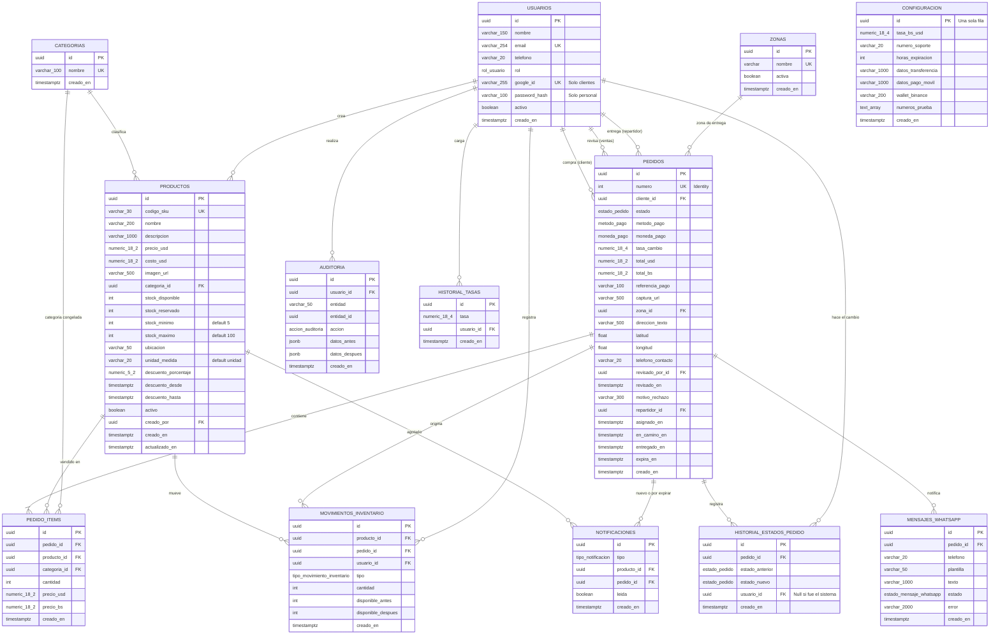

# Modelo de Datos

[← Volver al README](../README.md)

La base de datos es **PostgreSQL 15** y se genera con **Entity Framework Core 10 (Code-First)**. La configuración de cada tabla está en `Infrastructure/Persistencia/Configuraciones/` (Fluent API) y el script completo en [`database/InitialCreate.sql`](../database/InitialCreate.sql).

Convenciones:
- **Entidad base:** todas las entidades heredan de `BaseEntity` (`Core.Domain/Comun/BaseEntity.cs`), que define `Id` (`Guid`) y `CreatedAt` (`DateTime` en UTC). Por eso **todas las tablas** tienen `id` y `creado_en`.
- **Claves primarias UUID** en todas las tablas.
- **Fechas en UTC** (`timestamp with time zone`). `CreatedAt` se guarda en la columna `creado_en`, con `now()` por defecto; ese mapeo se configura una sola vez para todas las entidades en `ApplicationDbContext`.
- **Nombres en `snake_case`** (por ejemplo, la propiedad `StockDisponible` se guarda en la columna `stock_disponible`).
- **Montos** con precisión `numeric(18,2)` y tasas de cambio con `numeric(18,4)`.
- Las enumeraciones se guardan como **tipos enum nativos de PostgreSQL**.

---

## 1. Diagrama Entidad-Relación



---

## 2. Dimensiones Operacionales

El modelo cubre las cuatro dimensiones operacionales de un sistema de inventario. La tabla `productos` es el centro: cada una de sus columnas pertenece a una dimensión, y el resto de las tablas extiende esa dimensión al flujo de ventas y entregas.

### 2.1 Identificación Comercial

Qué es el producto y cómo se encuentra en el catálogo.

| Tabla | Columnas | Regla / uso |
| :--- | :--- | :--- |
| `productos` | `codigo_sku` | Código interno único (`VIV-0001`), guardado en mayúsculas; índice único `ix_productos_codigo_sku`. |
| `productos` | `nombre`, `descripcion`, `imagen_url` | Ficha que ve el cliente en la tienda. |
| `productos` | `unidad_medida` | Unidad de venta (`unidad`, `kg`, `litro`, `paquete`…). |
| `productos` | `categoria_id` → `categorias` | Clasificación en secciones del supermercado; `categorias.nombre` es único. |
| `productos` | `activo` | Borrado lógico: un producto inactivo sale del catálogo pero conserva su historial de ventas. |

### 2.2 Gestión Financiera

Cuánto cuesta, a cuánto se vende y cuánto se cobró.

| Tabla | Columnas | Regla / uso |
| :--- | :--- | :--- |
| `productos` | `precio_usd`, `costo_usd` | `numeric(18,2)`, nunca negativos. Margen unitario = `precio_usd − costo_usd`. |
| `productos` | `descuento_porcentaje`, `descuento_desde`, `descuento_hasta` | Oferta entre 0 y 100 % (excluidos), vigente en `[desde, hasta)`. |
| `pedido_items` | `precio_lista_usd`, `precio_usd`, `precio_bs` | Precio **congelado** al comprar: un cambio de precio posterior no altera ventas pasadas. |
| `pedidos` | `tasa_cambio`, `total_usd`, `total_bs`, `descuento_usd`, `descuento_bs` | Totales en las dos monedas con la tasa del día congelada. |
| `historial_tasas` | `tasa`, `usuario_id` | Cada tasa de cambio cargada, para auditar conversiones. |
| `cupones` | `tipo`, `valor`, `compra_minima_usd`, `usos_maximos` | Descuentos promocionales sobre el total del pedido. |

**KPIs:** ventas, ticket promedio, margen y ventas por categoría (dashboard KPI).

### 2.3 Control y Umbrales de Stock

Cuánto hay, cuánto está comprometido y cuándo reponer.

| Tabla | Columnas | Regla / uso |
| :--- | :--- | :--- |
| `productos` | `stock_disponible` | Lo que se puede vender. `CHECK >= 0`: nunca negativo, aun con compras simultáneas. |
| `productos` | `stock_reservado` | Apartado por pedidos pendientes de pago; se libera si el pedido expira o se rechaza. |
| `productos` | `stock_minimo` | Umbral de reposición (por defecto 5). Por debajo, el producto se marca **"Reponer"**. |
| `productos` | `stock_maximo` | Capacidad de almacenamiento (por defecto 100). `CHECK stock_maximo > stock_minimo`. |
| `movimientos_inventario` | `tipo`, `cantidad`, `disponible_antes`, `disponible_despues` | Kárdex: cada reserva, venta, liberación, reposición y ajuste. |
| `notificaciones` | `producto_id` | Aviso al personal cuando un producto se agota. |

**Semáforo de stock:** agotado (`disponible = 0`) → reponer (`disponible < mínimo`) → normal → sobre máximo (`disponible > máximo`).

### 2.4 Logística y Almacén

Dónde está la mercancía y cómo llega al cliente.

| Tabla | Columnas | Regla / uso |
| :--- | :--- | :--- |
| `productos` | `ubicacion` | Pasillo y estante en el almacén (`P3-E2`), para preparar pedidos. |
| `productos` | `stock_maximo` | Capacidad física del espacio asignado al producto. |
| `zonas` | `nombre`, `activa` | Zonas de entrega. |
| `pedidos` | `zona_id`, `direccion_texto`, `latitud`, `longitud`, `telefono_contacto` | Destino de la entrega. |
| `pedidos` | `repartidor_id`, `asignado_en`, `en_camino_en`, `entregado_en` | Asignación del repartidor y tiempos de cada etapa. |
| `historial_estados_pedido` | `estado_anterior`, `estado_nuevo`, `usuario_id` | Trazabilidad completa del pedido. |

**KPI de ocupación del almacén:** porcentaje de la capacidad usada, por producto, por categoría y global:

```
ocupación (%) = (stock_disponible + stock_reservado) / stock_maximo × 100
```

Se suma el stock reservado porque sigue físicamente en el almacén hasta la entrega. Rangos: < 20 % baja, 20–85 % óptima, 85–100 % alta y > 100 % saturada.

---

## 3. Diccionario de Datos

Tablas principales del modelo (equivalentes a `Categories`, `Products` y `Users`). Tipos, nulabilidad y valores por defecto tomados del esquema real de PostgreSQL 15 (`\d <tabla>`).

### 3.1 `categorias` (Categories)

| Columna | Tipo | Nulo | Defecto | Clave | Descripción |
| :--- | :--- | :---: | :--- | :---: | :--- |
| `id` | `uuid` | No | — | **PK** | Identificador de la categoría. |
| `nombre` | `varchar(100)` | No | — | **UK** | Nombre de la sección (Víveres, Bebidas…). |
| `creado_en` | `timestamptz` | No | `now()` | | Fecha de creación (UTC). |

- **Índices:** `pk_categorias` (PK), `ix_categorias_nombre` (único).
- **Referenciada por:** `productos.categoria_id` y `pedido_items.categoria_id`, ambas `ON DELETE RESTRICT`: no se puede borrar una categoría con productos o ventas.

### 3.2 `productos` (Products)

| Columna | Tipo | Nulo | Defecto | Clave | Dimensión | Descripción |
| :--- | :--- | :---: | :--- | :---: | :--- | :--- |
| `id` | `uuid` | No | — | **PK** | — | Identificador del producto. |
| `codigo_sku` | `varchar(30)` | No | — | **UK** | Identificación | Código interno único. |
| `nombre` | `varchar(200)` | No | — | | Identificación | Nombre comercial. |
| `descripcion` | `varchar(1000)` | Sí | — | | Identificación | Descripción para el catálogo. |
| `imagen_url` | `varchar(500)` | Sí | — | | Identificación | Imagen del producto. |
| `categoria_id` | `uuid` | No | — | **FK** → `categorias.id` | Identificación | Categoría del producto. |
| `unidad_medida` | `varchar(20)` | No | `'unidad'` | | Identificación | Unidad de venta. |
| `precio_usd` | `numeric(18,2)` | No | — | | Financiera | Precio de venta. `CHECK >= 0`. |
| `costo_usd` | `numeric(18,2)` | No | — | | Financiera | Costo de compra. `CHECK >= 0`. |
| `descuento_porcentaje` | `numeric(5,2)` | Sí | — | | Financiera | % de oferta, `CHECK > 0 AND < 100`. |
| `descuento_desde` | `timestamptz` | Sí | — | | Financiera | Inicio de la oferta. |
| `descuento_hasta` | `timestamptz` | Sí | — | | Financiera | Fin de la oferta, `CHECK hasta > desde`. |
| `stock_disponible` | `integer` | No | — | | Stock | Unidades vendibles. `CHECK >= 0`. |
| `stock_reservado` | `integer` | No | — | | Stock | Unidades apartadas por pedidos pendientes. `CHECK >= 0`. |
| `stock_minimo` | `integer` | No | `5` | | Stock | Umbral de reposición. `CHECK >= 0`. |
| `stock_maximo` | `integer` | No | `100` | | Stock / Almacén | Capacidad de almacenamiento. `CHECK > stock_minimo`. |
| `ubicacion` | `varchar(50)` | Sí | — | | Almacén | Pasillo y estante (`P3-E2`). |
| `activo` | `boolean` | No | — | | — | Borrado lógico. |
| `creado_por` | `uuid` | Sí | — | **FK** → `usuarios.id` | — | Usuario que registró el producto. |
| `creado_en` | `timestamptz` | No | `now()` | | — | Fecha de creación (UTC). |
| `actualizado_en` | `timestamptz` | Sí | — | | — | Última modificación. |

- **Índices:** `pk_productos` (PK), `ix_productos_codigo_sku` (único), `ix_productos_categoria_id`, `ix_productos_creado_por_id`, `ix_productos_activo_stock_disponible` (catálogo público).
- **Claves foráneas:** `categoria_id` → `categorias(id)` y `creado_por` → `usuarios(id)`, ambas `ON DELETE RESTRICT`.
- **Referenciada por:** `pedido_items`, `movimientos_inventario` y `notificaciones` (`ON DELETE RESTRICT`).

### 3.3 `usuarios` (Users)

| Columna | Tipo | Nulo | Defecto | Clave | Descripción |
| :--- | :--- | :---: | :--- | :---: | :--- |
| `id` | `uuid` | No | — | **PK** | Identificador del usuario. |
| `nombre` | `varchar(150)` | No | — | | Nombre completo. |
| `email` | `varchar(254)` | No | — | **UK** | Correo; una cuenta por correo. |
| `telefono` | `varchar(20)` | Sí | — | | Teléfono para WhatsApp. |
| `rol` | `rol_usuario` (enum) | No | — | | `cliente`, `ventas`, `repartidor` o `superadmin`. |
| `google_id` | `varchar(255)` | Sí | — | **UK** | Identificador de Google (solo clientes). |
| `password_hash` | `varchar(100)` | Sí | — | | Hash BCrypt (solo personal). |
| `activo` | `boolean` | No | — | | Usuario habilitado para iniciar sesión. |
| `creado_en` | `timestamptz` | No | `now()` | | Fecha de registro (UTC). |

- **Índices:** `pk_usuarios` (PK), `ix_usuarios_email` (único), `ix_usuarios_google_id` (único).
- **Restricción:** `ck_usuarios_credenciales`: un cliente debe tener `google_id`; el personal, `password_hash`.
- **Referenciada por:** `productos.creado_por`, `pedidos` (`cliente_id`, `revisado_por`, `repartidor_id`), `movimientos_inventario`, `historial_estados_pedido`, `historial_tasas`, `cupones`, `auditoria`, `eventos_analitica` (`ON DELETE RESTRICT`) y `refresh_tokens` (`ON DELETE CASCADE`).

---

## 4. Descripción de las Tablas

| Tabla | Para qué sirve |
| :--- | :--- |
| `categorias` | Secciones del supermercado (Víveres, Bebidas…). |
| `productos` | Catálogo. Guarda el stock en dos contadores: **disponible** (lo que se puede vender) y **reservado** (lo apartado por pedidos pendientes). El borrado es lógico con `activo`. |
| `usuarios` | Clientes y personal. Los clientes tienen `google_id`; el personal, `password_hash`. |
| `zonas` | Zonas de entrega; cada pedido indica la suya. |
| `pedidos` | Cada compra, con su estado, método de pago, comprobante, dirección, tasa de cambio congelada y fechas de cada etapa. |
| `pedido_items` | Productos de cada pedido, con **precio y categoría congelados** al momento de la compra. |
| `historial_estados_pedido` | Cada cambio de estado de un pedido: de qué estado a cuál, quién y cuándo. |
| `movimientos_inventario` | Cada entrada o salida de stock: reservas, ventas, liberaciones, reposiciones y ajustes. |
| `notificaciones` | Avisos para el personal: producto agotado, pedido nuevo y pedido por expirar. |
| `mensajes_whatsapp` | Registro de cada mensaje enviado (o bloqueado) al cliente. |
| `auditoria` | Quién cambió qué registro, con los datos antes y después en JSON. |
| `configuracion` | Parámetros del sistema: tasa del día, número de soporte, horas de expiración, datos de pago y números de prueba. |
| `historial_tasas` | Cada tasa de cambio cargada, con el usuario y la fecha. |

---

## 5. Restricciones de Integridad

Además de las claves foráneas, la base de datos protege las reglas del negocio con restricciones `CHECK` e índices únicos:

| Tabla | Restricción | Regla |
| :--- | :--- | :--- |
| `productos` | `precio_usd >= 0`, `costo_usd >= 0` | No hay precios negativos. |
| `productos` | `stock_disponible >= 0`, `stock_reservado >= 0` | El stock nunca queda negativo, incluso si dos compras llegan a la vez. |
| `productos` | `stock_minimo >= 0`, `stock_maximo > stock_minimo` | Límites de reposición coherentes (por defecto 5 y 100). |
| `productos` | `codigo_sku` único (`HasIndex(...).IsUnique()`) | No se repiten códigos; la búsqueda por SKU usa el índice. |
| `productos` | `precio_usd`, `costo_usd` con `HasPrecision(18, 2)` | Montos exactos en `numeric(18,2)`, sin errores de redondeo de punto flotante. |
| `productos → categorias` | `OnDelete(DeleteBehavior.Restrict)` | No se puede borrar una categoría que tenga productos (sin borrado en cascada). |
| `usuarios` | `ck_usuarios_credenciales` | Un cliente debe tener `google_id`; el personal debe tener `password_hash`. |
| `usuarios` | `email` y `google_id` únicos | Una cuenta por correo. |
| `pedidos` | `total_usd >= 0`, `total_bs >= 0`, `tasa_cambio > 0` | Totales y tasa válidos. |
| `pedidos` | `numero` único (columna *identity*) | Número correlativo legible (#1, #2…). |
| `pedido_items` | `cantidad > 0` | No hay líneas vacías. |
| `notificaciones` | `producto_id` o `pedido_id` obligatorio | Toda notificación apunta a algo. |
| `configuracion` | `id` fijo y `horas_expiracion > 0` | Solo existe una fila de configuración. |
| `historial_tasas` | `tasa > 0` | Tasas válidas. |
| `categorias`, `zonas` | `nombre` único | Sin duplicados. |

### Índices para consultas frecuentes
- `pedidos (estado, creado_en)` y `pedidos (estado, expira_en)`: bandeja de pendientes, job de expiración y KPIs.
- `pedidos (zona_id)` y `pedido_items (producto_id)`: ventas por zona y por producto.
- `productos (activo, stock_disponible)`: catálogo público.
- `movimientos_inventario (producto_id, creado_en)`: historial de movimientos de un producto.
- `notificaciones (leida, creado_en)`: notificaciones sin leer.
- `auditoria (creado_en)` y `auditoria (entidad, entidad_id)`: consultas de auditoría.

---

## 6. Enumeraciones

| Enum | Valores |
| :--- | :--- |
| `rol_usuario` | `cliente`, `ventas`, `repartidor`, `superadmin` |
| `estado_pedido` | `pendiente`, `aprobado`, `rechazado`, `expirado`, `asignado`, `en_camino`, `entregado` |
| `metodo_pago` | `transferencia`, `pago_movil`, `binance` |
| `moneda_pago` | `VES`, `USDT` |
| `tipo_movimiento_inventario` | `reserva`, `venta`, `liberacion`, `reposicion`, `ajuste` |
| `accion_auditoria` | `crear`, `editar`, `borrar`, `descargar_reporte` |
| `tipo_notificacion` | `stock_agotado`, `pedido_nuevo`, `pedido_por_expirar` |
| `estado_mensaje_whatsapp` | `enviado`, `error`, `bloqueado_lista_blanca` |

---

## 7. Datos Semilla

Se siembran con `ModelBuilder.HasData()` en `ApplicationDbContext.OnModelCreating` (método `SembrarDatosMaestros`), a partir de `Infrastructure/Persistencia/Semillas/DatosSemilla.cs`, así que quedan dentro de las migraciones. Cada producto trae precio, costo, stock, límites mínimo/máximo, ubicación en el almacén y unidad de medida:

| Categoría | Productos (SKU) |
| :--- | :--- |
| Víveres | VIV-0001 a VIV-0004 (harina, arroz, aceite…) |
| Lácteos y huevos | LAC-0001 a LAC-0003 (leche, queso, huevos) |
| Bebidas | BEB-0001, BEB-0002 (café, refresco) |
| Limpieza del hogar | LIM-0001, LIM-0002 (detergente, cloro) |

**Zonas de entrega:** Centro, Barrio Obrero, Pueblo Nuevo, La Concordia, Santa Teresa.

Al arrancar la API también se crean la fila de `configuracion` (con 5 horas de expiración) y el usuario superadmin inicial.
